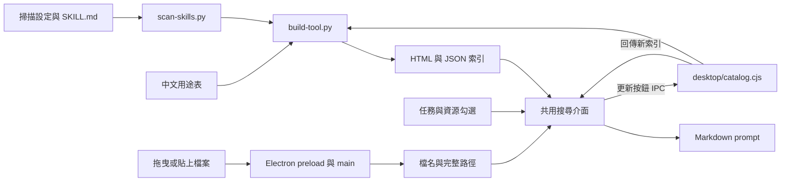

# SkillShelf：技術導讀

SkillShelf 將不同來源的 `SKILL.md` 整理成同一份可搜尋清單，協助使用者理解用途、管理常用項目，再組成可貼給 Agent 的 Markdown prompt。本文以接手開發與開源使用者為讀者；完整操作說明見[繁體中文 README](README.zh-TW.md)，也可切換至[英文版](README.md)。

## 功能與使用流程

1. 掃描使用者、共用、專案與 plugin 來源，包含 ECC 及其 migrated command Skills。
2. 以中文需求、英文完整名稱、分類或來源搜尋，查看中文用途與 Skill 原文。
3. 收藏、隱藏或還原項目，匯入與匯出管理設定。
4. 在「任務」填寫需求，於桌面版拖曳、貼上或選取資源檔案，自動帶入檔名與完整路徑。
5. 勾選資源後複製 Markdown，交給能存取該路徑的 Agent。
6. 在桌面版按「更新 Skills 清單」，於目前視窗重新掃描，無須重啟 App。

清單管理不會安裝、卸載或停用原有 Skill；「隱藏」只影響本工具的結果。複製 prompt 也不會自動執行 Skill。Agent 是否支援該完整名稱及是否已載入，仍由 Agent 本身決定。

## 快速啟動

桌面版需要 Python 3.10 以上、Node.js 22.12 以上。解壓縮原始碼後，在工具資料夾開啟終端機：

```sh
npm install
npm run desktop
```

Electron 執行檔可能在首次啟動時下載，需要網路。Windows 後續可雙擊 `開啟 SkillShelf.cmd`；啟動錯誤可查看工具資料夾內的 `desktop.log`、`desktop-error.log`，或從終端機執行 `npm run desktop` 查看訊息。

僅使用 HTML 版時執行 `python launch.py`；若環境使用 `python3` 命令，可改成 `python3 launch.py`。HTML 版支援搜尋、管理及手動輸入資源路徑；直接開啟 HTML 不具備原生檔案路徑辨識與按鈕重新掃描能力。

## 技術組成

| 層次 | 實作 | 責任 |
| --- | --- | --- |
| 掃描與組裝 | Python 標準函式庫 | 探索 Skills、解析基本 metadata、合併中文用途、建立 HTML 與 JSON |
| 介面與搜尋 | 原生 HTML、CSS、JavaScript | 搜尋排序、篩選、收藏、資源勾選與 Markdown 產生 |
| 桌面執行環境 | Electron 45.0.0 | 視窗、原生選檔、檔案路徑、剪貼簿及重新掃描 |
| 介面持久化 | localStorage | 收藏、隱藏、最近查看與資源清單 |
| 自動化驗證 | Python unittest、Playwright 1.62.1 | Scanner、瀏覽器介面、Electron 整合與可攜式驗證 |

版本以 [package.json](package.json) 與 lockfile 為準。HTML 與桌面版共用同一份介面程式，桌面能力集中在 `desktop/`。

## 架構與資料流



### Skills 掃描

`scan-skills.py` 從 `skills-config.json` 取得來源，遞迴搜尋 `SKILL.md`。解析器擷取 frontmatter 中的 `name`、`description`，保留完整原文；它不是完整 YAML parser。沒有名稱時使用檔案所在資料夾名稱。

Plugin cache 依 `marketplace/plugin/version` 結構探索，辨識 `.codex-plugin/plugin.json`、`.claude-plugin/plugin.json` 或根目錄 `plugin.json`，選取最新快取版本並讀取宣告的 Skills 來源。ECC 另包含 `.codex-plugin/migrated-command-skills`。完整名稱使用 `plugin:skill-name`，保留大小寫。

同一實體檔案不重複收錄；不同檔案可以有同一完整名稱，因此檔案數與名稱數可能不同。預設排除測試 fixture、範例、資產與參考資料等附屬目錄；`includeAuxiliary: true` 可擴大盤點範圍。設定根目錄不存在及個別 Skill 讀取失敗會列入診斷；設定或 manifest 格式錯誤可能使整次掃描失敗。

`build-tool.py` 將掃描結果與兩份中文用途表合併，輸出：

| 產物 | 內容 |
| --- | --- |
| `skills-raw.json` | 原始盤點、來源路徑、Skill 原文與讀取診斷 |
| `skills-index.json` | 加上分類、中文標題、用途與關鍵字的索引 |
| `Skills查詢工具.html` | 內嵌索引、樣式與介面程式的單一 HTML |

中文用途表使用 `分類|完整名稱|中文標題|中文用途|關鍵字` 格式，檔名雖為 `.tsv`，實際分隔符號是 `|`。新增未知 Skill 仍可搜尋，但需在 `skill-guide.tsv` 或 `plugin-guide.tsv` 補上中文內容，才會有專屬用途說明。

### 搜尋與即時更新

`tool.js` 對名稱、中文標題、用途、關鍵字及原文建立記憶體索引，以大小寫正規化、部分簡繁字對照、關鍵字權重與常見需求規則排序。這是確定性的文字比對，搜尋結果仍需由使用者確認用途。

桌面版的更新流程為：

1. 按下「更新 Skills 清單」，按鈕顯示更新中並暫停重複點擊。
2. preload 呼叫固定的 `catalog:refresh` IPC；main 確認請求來自本工具主頁。
3. `desktop/catalog.cjs` 非同步執行 `build-tool.py`，重新讀取來源設定、Skills 與中文用途表。
4. 成功後將新索引回傳介面，更新搜尋、來源數量、Plugin 版本與清單時間，不重新載入頁面。
5. 保留搜尋條件、任務、收藏與資源勾選；若目前 Skill 已移除，依目前搜尋結果選取可用項目。若沒有結果，顯示空清單並移除複製按鈕，避免輸出已移除的指令；任務與資源仍留在記憶體，選到其他 Skill 後可繼續使用。

同時發生的掃描請求共用同一個進行中的工作，單次逾時為 120 秒。掃描失敗時顯示錯誤，畫面保留原清單，可修正來源後再按一次。這是按鈕觸發更新，沒有背景自動監看。工具更新不會要求 Agent 同步重新載入 Skills。

若升級前已有舊版 App 程序開啟，需要重新開啟一次以載入新增的原生功能；載入新版後，每次更新清單都直接使用按鈕，不需重啟。

### 資源與 Markdown

桌面版拖曳以 Electron `webUtils.getPathForFile()` 取得磁碟檔案路徑；選檔使用原生對話框；Windows 貼上使用 Python `ctypes` 讀取 `CF_HDROP`，取得檔案總管複製的檔案清單。未存檔的截圖或只有記憶體內容的檔案沒有來源路徑，必須先存檔。

原生入口檢查絕對路徑、存在性及檔案／資料夾類型。收納清單最多 100 筆，以路徑去重；新增項目預設勾選。手動輸入路徑是另一路徑，不保證檔案存在。重新勾選或修改路徑時，預覽同步更新。

```markdown
/sepia-recreate

# 任務
請依原稿改寫文章，保留引用與研究數據。

# 資源
1. 檔案：研究原稿.md
   路徑：C:\Projects\research\研究原稿.md
```

第一行固定為 `/完整名稱`；未填任務時顯示「帶上自己的需求」，沒有勾選資源時省略 `# 資源`。收納的是檔名、路徑與勾選狀態，沒有將資源內容搬入工具。相對資源路徑由目標 Agent 的工作目錄解析；電腦上的絕對路徑不一定能被遠端 Agent 存取。

## 設定與持久化

掃描來源的 `./`、`../` 相對於**工具所在資料夾**，`~/` 對應使用者家目錄；`~/.codex` 優先採用 `CODEX_HOME`。工具不綁定特定 Windows 帳號。

```json
{
  "schemaVersion": 1,
  "skillRoots": ["~/.codex/skills", "~/.agents/skills", "./my-skills"],
  "pluginCaches": ["~/.codex/plugins/cache", "~/.claude/plugins/cache"],
  "includeAuxiliary": false
}
```

在「管理與來源 → 設定掃描來源」按「下載掃描設定」，會取得 `skills-config.json`；放回工具資料夾後，於桌面版按「更新 Skills 清單」套用。這與「匯出管理設定」產生的 `skills-preferences.json` 不同，後者只搬移收藏與隱藏，不改掃描來源。兩者都不會直接覆寫 Agent 的設定。

收藏、隱藏、最近查看與資源清單存在 localStorage；任務文字只保留於目前頁面，關閉或重新載入會失去。桌面版與瀏覽器版的儲存空間不共用，管理設定匯出僅包含收藏與隱藏。`SKILLS_TOOL_USER_DATA` 可指定 Electron profile 資料夾，`SKILLS_TOOL_PYTHON` 可指定桌面版使用的 Python 執行檔。

產生的 HTML 與索引含有本機 Skill 原文及來源路徑，不宜直接作為開源發布檔案。原始碼匯出採明確白名單排除這些產物。

## 原生介面邊界

Electron renderer 啟用 `contextIsolation`、`sandbox`、`webSecurity` 並關閉 `nodeIntegration`。preload 僅提供檔案路徑、選檔、貼上、文字複製與更新清單等固定能力；不提供任意 shell 或檔案系統呼叫。

Main 對 IPC 檢查視窗、主 frame 與本機頁面 URL，阻擋頁面導向、新視窗與 HTTP(S) 請求。剪貼簿讀取由使用者明確貼上觸發。掃描會讀取 Skill 文字；資源收納只檢查路徑，不讀取資源內容。這些邊界是目前程式的實作，並非正式安全稽核認證。

## 開發入口與驗證

| 想修改的功能 | 程式入口 |
| --- | --- |
| 掃描根目錄、plugin 規則、去重 | `skills-config.json`、`scan-skills.py` |
| 中文用途、搜尋關鍵字 | `skill-guide.tsv`、`plugin-guide.tsv` |
| 產出格式、分類與嵌入資料 | `build-tool.py` |
| 搜尋、狀態、資源與 prompt | `tool.js` |
| 版面與樣式 | `tool-shell.html`、`tool.css` |
| App 圖示與生成提示詞 | `assets/app-icon.png`、`assets/app-icon.ico`、`assets/icon-prompt.md`；`build-tool.py` 將頁面縮圖內嵌於 HTML |
| 桌面啟動與 IPC | `desktop/start.cjs`、`desktop/main.cjs`、`desktop/preload.cjs` |
| Windows 桌面捷徑 | `create-desktop-shortcut.ps1`，以目前資料夾及使用者桌面產生 SkillShelf 捷徑 |
| 原生路徑與貼上 | `desktop/resources.cjs`、`desktop/read-file-clipboard.py` |
| 按鈕重新掃描 | `desktop/catalog.cjs`、`tool.js` 的 `refreshSkills()` |
| 開源包檔案白名單 | `export-source.py` |

在專案目錄執行：

```sh
python -m unittest test_scanner -v
npx playwright install chromium
npm test
npm run test:desktop
npm run test:refresh
python verify-portable.py
```

`npm test` 預設使用合成索引，不要求測試電腦安裝全部 Skills。檢查實際索引時，先執行 `python build-tool.py`，再設定 `SKILLS_TOOL_REAL_CATALOG=1`。桌面資源測試會暫時寫入測試剪貼簿內容並於結束後還原；更新測試在隔離資料夾建立與修改 Skill fixture，不改動已安裝的 Skills。

Windows PowerShell 的實際索引測試指令如下；測試後移除環境變數可恢復合成索引模式：

```powershell
python build-tool.py
$env:SKILLS_TOOL_REAL_CATALOG = '1'
npm test
Remove-Item Env:SKILLS_TOOL_REAL_CATALOG
```

目前 Windows 測試涵蓋 scanner、搜尋與管理、原生完整路徑與剪貼簿，以及按鈕更新。macOS／Linux 原生貼上尚未實機驗證。測試結果是工具行為的證據，不等於每一個 Skill 已在目標 Agent 執行成功。

2026-10-22 Windows 開發環境的實際驗證結果如下；數量是此版本測試結果，不是對其他電腦的預設保證：

| 驗證 | 結果 |
| --- | --- |
| Scanner unittest | 14 項通過 |
| Chromium 實際索引介面回歸 | 50 項通過，580 份 Skill 檔案，未發現頁面 JS 錯誤 |
| Electron 資源整合 | 9 項通過 |
| 更新按鈕與狀態保留 | 9 項通過，確認沒有頁面重載與程序重啟 |
| 原始碼搬移與相對路徑 | 4 項檢查通過 |

重新執行對應腳本會產生 `verification-results.json`、`desktop-verification-results.json`、`refresh-verification-results.json` 與 `portable-verification-results.json`。這些是個別測試環境的報告，不收錄於開源包。

## 開源發布

執行 `python export-source.py` 會產生 `dist/skillshelf-source.zip`，收錄程式、設定、用途表與說明，不包含本機生成索引、Skill 原文、資源清單、測試截圖及 `node_modules`。下載者需自行安裝依賴並掃描自己的來源，目前尚未提供已封裝的桌面安裝程式。

工具程式採 MIT 授權；外部 Skills 維持各自授權，詳見 [LICENSE](LICENSE) 與 [THIRD_PARTY_NOTICES.md](THIRD_PARTY_NOTICES.md)。
